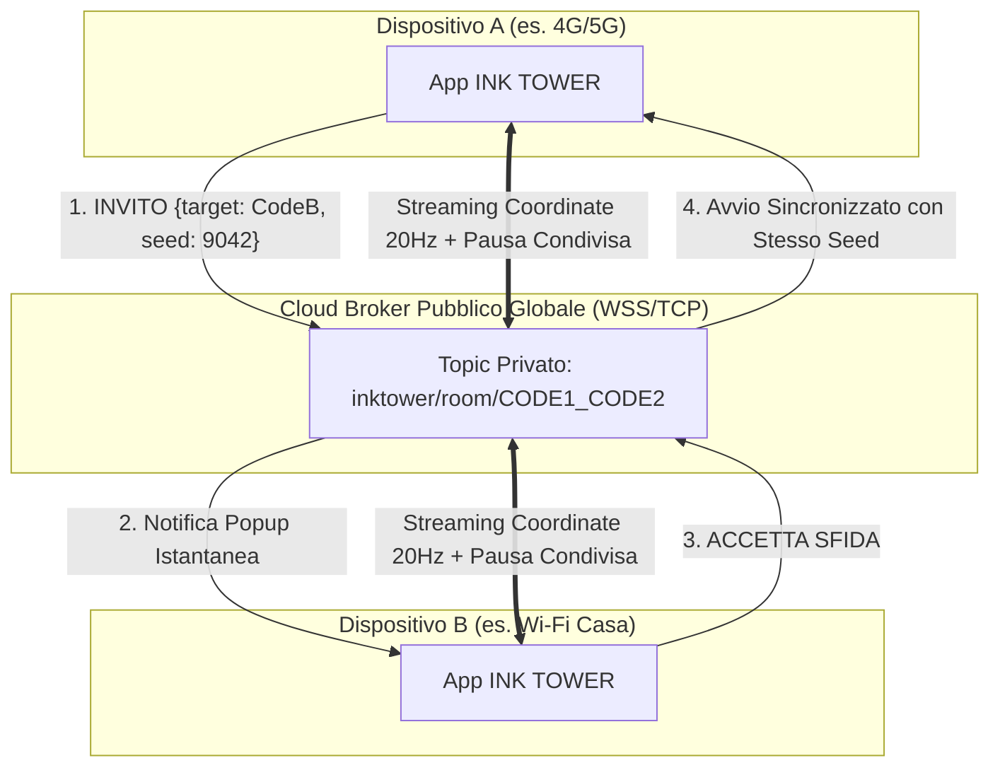

# Piano di Implementazione: P2P Cross-Network (4G/5G/Wi-Fi), Nuova UI Duello & Bilanciamento

## 1. P2P Cross-Network Globale (4G/5G e Wi-Fi Differenti)
### Il Problema delle Connessioni Differenti
Attualmente il P2P operava tramite broadcast UDP locale (`255.255.255.255:45888`), che funziona unicamente se entrambi i dispositivi sono collegati alla **stessa rete Wi-Fi**. Se un giocatore usa il 4G/5G di Vodafone o Iliad e l'altro è sul Wi-Fi di casa (o un altro operatore), i pacchetti UDP non possono attraversare i router e il NAT/CGNAT degli operatori telefonici.

### La Soluzione Architetturale: Hybrid P2P Broker
Integriamo un'architettura **Ibrida Globale** ad altissima velocità e zero manutenzione:
1. **Canale Globale Internet (Pure-Dart `mqtt_client`)**:
   - Connessione automatica al broker sicuro globale (es. `broker.emqx.io` / `broker.hivemq.com` su WSS / TCP).
   - **Nessun server da pagare, nessun account o chiave API da registrare**: il protocollo è pubblico, leggero, aperto e gestisce milioni di messaggi concorrenti in tutto il mondo con latenze minime (~30-50ms).
   - **Indirizzamento tramite Codice Amico a 8 cifre**:
     - Ogni giocatore si mette in ascolto sul proprio topic univoco: `inktower/inbox/INK-XXXXXXXX`.
     - Quando sfidi un amico digitando il suo codice (es. `INK-84729103`), l'invito viene recapitato istantaneamente al suo telefono ovunque si trovi (a casa, in treno in 4G o all'estero).
     - Quando l'amico accetta, entrambi si collegano alla stanza di duello: `inktower/room/CODE1_CODE2` e scambiano le posizioni di scalata a 20Hz.
2. **Fallback Offline Locale (UDP 45888)**:
   - Se i telefoni sono senza connessione Internet (es. in aereo o su un hotspot locale), il gioco continua a funzionare tramite broadcast UDP sulla rete locale!
3. **Fallback Bot di Allenamento**:
   - Se l'amico è offline o non risponde entro 5 secondi, è possibile toccare *"Gioca contro il Bot (Allenamento)"*.

---

## 2. Mare d'Inchiostro Condiviso & Fix "Morte di Infarto" del Bot
- **Marea Equa in P2P**:
  - In [`InkFloodWave.update`](file:///C:/Users/ale05/OneDrive/Desktop/ArgonApp/lib/game/components/ink_flood_wave.dart), quando `game.isP2PMatch == true`, il target di inseguimento dell'onda (`targetY`) viene calcolato sulla posizione del **giocatore più in basso** (`max(game.player.position.y, game.ghostOpponent!.position.y)`).
  - La fuga in avanti del primo giocatore non provocherà più l'innalzamento improvviso della marea: l'avversario trailing non verrà mai annegato a tradimento!
- **Eliminazione della morte casuale del bot a 30m**:
  - In [`GhostOpponentComponent`](file:///C:/Users/ale05/OneDrive/Desktop/ArgonApp/lib/game/components/ghost_opponent.dart), rimosso il codice `if (roll < 0.38) _targetDeathMeters = 28.0 + ...`.
  - Nella modalità **🏁 Traguardo 100m**, il bot scalerà con salti regolari puntando al traguardo (80-100m) per una corsa all'ultimo millesimo.

---

## 3. Pausa Condivisa Simultanea ("Come sullo stesso dispositivo")
- Quando un giocatore preme il tasto Pausa (`||`) durante un duello P2P:
  - Invia il pacchetto `PAUSE {v: true, by: playerName}` sulla stanza di duello.
  - Entrambi i giochi congelano la fisica (`timeScale = 0.0`) e mostrano l'overlay di pausa con la dicitura: *"PARTITA SOSPESA DA [NOME]"*.
  - Quando uno dei due preme *"RIPRENDI"*, viene inviato `PAUSE {v: false}` ed entrambi ripartono insieme.

---

## 4. Nuova Schermata GameOver P2P con Tracciato Avversario in Rosso
- In [`GameOverOverlay`](file:///C:/Users/ale05/OneDrive/Desktop/ArgonApp/lib/ui/game_over_overlay.dart):
  - In modalità P2P (`isP2PMatch == true`):
    - **Nascosti** il tasto *"Riprova Singolo"* e il tasto *"Condividi"*.
    - **Mini-mappa a due colori**: visualizza sia la scia della tua scalata, sia la scia dell'avversario disegnata in **ROSSO RISOGRAPH (`palette.vermilionHazard`)** per confrontare dove e come avete scalato.
    - **Pulsanti confermati**: `⚔️ RIVINCITA IMMEDIATA` (riavvia subito un altro duello con lo stesso amico) e `TORNA AL MENU`.

---

## 5. Pulizia Menu Principale: Niente Più Numeri sui Tasti
- In [`MainMenuOverlay`](file:///C:/Users/ale05/OneDrive/Desktop/ArgonApp/lib/ui/main_menu_overlay.dart):
  - Rimossi i badge numerici (`badgeText: '${storage.friendsList.length} 👥'` e `'${unlocked}/${total}'`) dalle card secondarie di **Amici** e **Abilità**.
  - Il menu torna ad essere pulito, essenziale ed elegante.

---

## 6. Sezione Amici: Icona "X" & Finestra di Conferma Rimozione
- In [`FriendsAndP2PDialog`](file:///C:/Users/ale05/OneDrive/Desktop/ArgonApp/lib/ui/friends_p2p_overlay.dart):
  - Sostituita l'icona del cestino con un'icona **`✕`** (`Icons.close_rounded`).
  - Al tocco, compare un dialogo modale di conferma:
    - *"Rimuovere [Nome Amico]?"*
    - *"Sei sicuro di voler eliminare questo amico dalla tua lista?"*
    - Tasti *"ANNULLA"* e *"RIMUOVI"* (in colore vermiglio).

---

## 7. Verifica e Adattamento Multilingua (IT, EN, ES, FR, DE, PT)
- In [`ProfileDialog`](file:///C:/Users/ale05/OneDrive/Desktop/ArgonApp/lib/ui/profile_overlay.dart):
  - Griglia icone profilo convertita da 3 a **2 colonne** con card spaziose.
  - Testo dei requisiti a **`11px`** in grassetto su 2 righe, prevenendo qualsiasi rimpicciolimento esasperato in lingue con parole lunghe come il tedesco (*"Beende 3 Mal in den Top 3"*) o il francese.

---

## 8. Centratura Tasto Abilità Attiva nell'HUD
- In [`HudOverlay`](file:///C:/Users/ale05/OneDrive/Desktop/ArgonApp/lib/ui/hud_overlay.dart):
  - Spostato l'allineamento da `Alignment.bottomRight` ad **`Alignment.bottomCenter`**.
  - Distanza calibrata per non interferire né con la fionda né con la gesture bar di Android/iOS.

---

## 9. Codice Amico a 8 Cifre & Aggiunta Veloce (1 Solo Campo)
- In [`StorageService`](file:///C:/Users/ale05/OneDrive/Desktop/ArgonApp/lib/services/storage_service.dart):
  - Codice generato nel formato `INK-XXXXXXXX` (8 cifre, da `10000000` a `99999999`, oltre 90 milioni di combinazioni).
- In [`FriendsAndP2PDialog`](file:///C:/Users/ale05/OneDrive/Desktop/ArgonApp/lib/ui/friends_p2p_overlay.dart):
  - Rimosso il campo separato del nome: c'è un unico campo di input espanso dove inserire direttamente il codice a 8 cifre.

---

## 10. Protezione Anti-Perdita Dati (Aggiornamenti & Debug)
- In `android/app/build.gradle.kts`:
  - Firma di debug unificata a `upload-keystore.jks` (la stessa di release) così Android non disinstalla mai l'app e non cancella i salvataggi durante i debug su telefono.
- In [`StorageService`](file:///C:/Users/ale05/OneDrive/Desktop/ArgonApp/lib/services/storage_service.dart):
  - Salvaguardia **High-Water Mark** che garantisce che livelli e record su disco non vengano mai retrocessi.

---

## Piano di Verifica

### Test Automatici
- `flutter analyze`: verifica statica a 0 errori e 0 warning.
- `flutter test`: tutti i 23 test automatici devono passare a pieni voti (codice a 8 cifre, parsing pacchetti P2P, High-Water Mark).

### Verifica sul Pixel 9
- Compilazione e installazione con `adb install -r build\app\outputs\flutter-apk\app-debug.apk`.
- Test della sfida su 4G/5G con codice amico.
- Verifica tracciato rosso avversario nel GameOver.
- Verifica tasto abilità centrato in basso e assenza di numeri nel menu principale.
